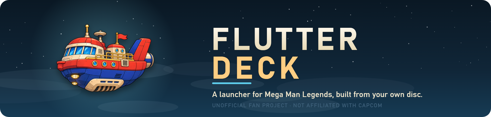

<p align="center"></p>

<p align="center">
  
  
  
  
  
  
</p>

<h3 align="center">Launch Mega Man Legends 1, 2 and Tron Bonne from your own disc.<br>One program. Nothing else to install.</h3>

<p align="center">
  <a href="#what-it-does">What it does</a> ·
  <a href="#how-it-works">How it works</a> ·
  <a href="#which-discs-you-need">Discs</a> ·
  <a href="#status">Status</a> ·
  <a href="#build-it-yourself">Build it yourself</a> ·
  <a href="#documentation">Documentation</a> ·
  <a href="#legal">Legal</a>
</p>

---

Flutter Deck is a free, unofficial launcher for **Mega Man Legends**, **Mega Man Legends 2** and **The Misadventures of Tron Bonne** on Windows. It lives on a ship deck. You point it at the disc image you already own, and it takes care of the rest: your library, your picture settings, your saves, your music and your friends.

It never contains the game. Every player builds their own copy from their own disc, on their own PC.

## What it does

| | Feature | What you get | State |
| :-: | --- | --- | --- |
| 🚀 | **Play** | Starts Mega Man Legends 1, Mega Man Legends 2 and The Misadventures of Tron Bonne from your own game program, after readiness checks. | ✅ Built and tested. Checked in play (Legends 1). Games 2 and 3: features coming soon |
| 📚 | **Library** | A grid of your games. Covers can come from your own disc code (off until you turn them on). | ✅ Built and tested |
| 🛠️ | **Build my game** | One button builds the game from your disc on your PC, with progress and plain error messages. | ✅ Built and tested |
| 👥 | **Play with a friend** | Host or join with an invite code. Direct connection, no server, and help with your router. | ✅ Built and tested |
| 🎛️ | **In-game overlay** | A pill at the top of the game window, with pause, restart, stop, full screen and a settings menu. Hotkey **Ctrl+Alt+O**. | ✅ Built and tested |
| 🖼️ | **Picture presets** | Pick a picture look while you play. [DSI Prism](docs/specs/SPEC-presets.md) applies it to the running game. | ✅ Built and tested. Checked on a running game |
| ⌨️ | **Key editor** | Change the keyboard keys for the game. | ✅ Built and tested |
| 💾 | **Saves** | Back up and restore your memory card. | ✅ Built and tested |
| 🎵 | **Music** | Original loops start with the launcher at 20% volume. Add your own WAV files. | ✅ Built and tested |
| 🔄 | **Updates and installer** | A signed self-updater and a per-user installer with no administrator prompt. | ✅ Built and tested |
| 🔍 | **Window scaler** | An experimental scaler for a local window, with several filters. | ✅ Built and tested. Experimental |

Every feature above is built and tested. Work continues on all of them.

## How it works

1. **Point it at your disc.** Flutter Deck finds the disc image of your game (Mega Man Legends, Mega Man Legends 2 or The Misadventures of Tron Bonne) in a folder you choose. It checks the files and keeps only a reference to them.
2. **Build your game.** The launcher builds the game from your disc, on your PC. The finished game program stays on your PC and never goes into this repository or into a release.
3. **Play.** Press Play. Change the picture, the keys and the volume while you play, or invite a friend.

## Which discs you need

You need your own copy of each game you want to play: the **US (NTSC-U)** release, as a disc image. Other regions are not supported.

| Game | Disc code | File Flutter Deck reads from the disc |
| --- | --- | --- |
| Mega Man Legends | SLUS-00603 | `ROCK_NEO.EXE` |
| Mega Man Legends 2 | SLUS-01140 | `SLUS_011.40` |
| The Misadventures of Tron Bonne | SLUS-00896 | `TRON.EXE` |

- Use a **CUE** disc image: a `.cue` file with its `.bin` data beside it. Flutter Deck does not make the image for you.
- Flutter Deck looks in a folder you choose, and up to three folders below it. It recognises a game by the file inside the disc, not by the file name.
- It only remembers where your disc image is. It never copies the disc.
- Building a game takes about 2 to 60 minutes and up to about 2 GB of free space, depending on the game and your PC.

## Status

Flutter Deck is in **beta**: it is still in active development. Every feature in the table is built and tested, and each one is still being improved.

Most of the 84 entries in the feature catalogue are ideas for later, not features yet.

Each feature page says what was tested and how.

## Build it yourself

Flutter Deck is native C# and WPF. It uses the .NET Framework compiler that comes with Windows. There is no package restore and no installer to run first.

```powershell
powershell -NoProfile -File .\scripts\build.ps1
```

Run `FlutterDeck.exe` directly. Each feature has its own check script, for example:

```powershell
powershell -NoProfile -File .\scripts\check-runtime.ps1
```

## Documentation

| Topic | Page |
| --- | --- |
| Playing the game | [SPEC-play.md](docs/specs/SPEC-play.md) |
| Building the game from your disc | [SPEC-builder.md](docs/specs/SPEC-builder.md) |
| The Misadventures of Tron Bonne (game 3) | [SPEC-game3.md](docs/specs/SPEC-game3.md) |
| Playing with a friend | [SPEC-multiplayer.md](docs/specs/SPEC-multiplayer.md) |
| The in-game overlay | [SPEC-overlay.md](docs/specs/SPEC-overlay.md) |
| Picture presets and DSI Prism | [SPEC-presets.md](docs/specs/SPEC-presets.md) |
| The library and covers | [SPEC-library.md](docs/specs/SPEC-library.md), [SPEC-covers.md](docs/specs/SPEC-covers.md) |
| Keys, saves and music | [SPEC-keys.md](docs/specs/SPEC-keys.md), [SPEC-saves.md](docs/specs/SPEC-saves.md), [SPEC-music.md](docs/specs/SPEC-music.md) |
| Updater and installer | [SPEC-updater.md](docs/specs/SPEC-updater.md), [SPEC-installer.md](docs/specs/SPEC-installer.md) |
| The window scaler | [SPEC-scaling.md](docs/specs/SPEC-scaling.md) |
| Everything the launcher can and cannot do | [CAPABILITIES.md](docs/CAPABILITIES.md) |

## Legal

Flutter Deck is an **unofficial fan project**. It is not affiliated with, endorsed by or sponsored by Capcom. Mega Man, Mega Man Legends, The Misadventures of Tron Bonne and Rockman DASH are trademarks or copyrights of Capcom Co., Ltd.

It contains **no game files, no BIOS files, no game audio and no game artwork**, and it downloads none. Players use files they already own.

The code is under the [MIT licence](LICENSE), copyright Dead Signal Interactive. The ship artwork and the music loops are original or AI-generated for this launcher. [NOTICE.md](NOTICE.md) has the full terms.

<p align="center"><sub>Made by Dead Signal Interactive · Flutter Deck is free · Not affiliated with Capcom</sub></p>


